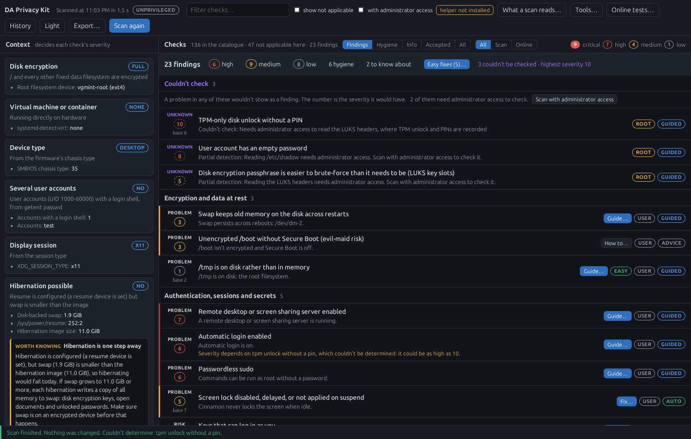

# DA Privacy Kit

A desktop app that finds common privacy issues on a Linux computer and, where it is safe, fixes them, with
tools for your files, drives, browsing and apps beside it. It says how much each finding matters on *this*
machine, shows exactly what a fix will change before making it, and can put it back. Scans are read-only and
work fully offline.

> [!WARNING]
> **Public beta: expect bugs,** in what it detects, in what it tells you, and in what its fixes and tools do.
> For now it is best used to scan, to learn about your own system and to try its tools: don't rely on it yet
> for critical privacy matters. It isn't risk-free either: several fixes and tools run commands with
> administrator rights, and a bug in one of those can affect the whole system. Keep backups.
>
> It is no replacement for [Tails](https://tails.net/) or [Qubes OS](https://www.qubes-os.org/), it isn't
> antivirus, and it doesn't make you anonymous online.



## What it does

- **Scans the machine, changing nothing.** 125 checks of disk encryption and swap, logins and the screen
  lock, the network, browsers, telemetry, what the desktop and your apps record, sandboxing and updates.
  Nothing leaves the computer.
- **Rates each finding for this machine.** No disk encryption matters more on a laptop than on a virtual
  machine; a saved password matters less on an encrypted disk. A *problem* is something wrong now, a *risk*
  something possible, partial or not happened yet, and what couldn't be checked is listed first, never
  passed over. Caches and histories every computer has are listed apart and cleaned, not counted.
- **Fixes what it safely can.** A fix shows its dry run first: every setting, file and command. Settings
  changes, including the ones made as administrator, are recorded and can be reverted from History; deleting
  caches and histories can't be undone, so each is confirmed on its own. *Easy fixes…* gathers the ones that
  cost you nothing, or next to nothing.
- **Guides you through the rest.** What needs your decisions, a passphrase or a restart is a step-by-step
  guide for this machine, each change shown and confirmed on its own; what the app shouldn't do for you is
  explained, with the commands.
- **Keeps track.** Accept a finding as a known risk and it stays hidden until its severity rises. Each scan
  says what is new, resolved or worse since the last one, what newly starts at login, and whether a fix has
  been undone. A scheduled scan notifies only about those.
- **Teaches.** Every check says what leaks, to whom, and why its fix works, and every action the app takes
  is shown as the command that does it.

## Tools

The Tools… button holds what you start yourself, on files, folders or drives you choose:

- **Verify a download**: is this file the one its makers published? From the signature or signed checksum
  list beside it, with the release keys of Linux Mint, Ubuntu, Debian, Fedora, Arch Linux, CachyOS, Kali,
  Tails, Qubes OS, Whonix, openSUSE, Manjaro, EndeavourOS, Tor Browser and Mullvad Browser, Mullvad VPN,
  Proton VPN, IVPN, VeraCrypt, KeePassXC, Cryptomator and Mozilla built in, and this app's own, each pinned
  to the fingerprint on the project's own site.
- **Remove metadata**: what photos and documents give away (where, who, which device), one file or whole
  folders, and clean copies made with mat2.
- **RAM disk**: a folder in memory, opened when you want it and overwritten when you close it.
- **Tor or Mullvad Browser in memory**: downloads either browser into a RAM disk, checks its signature and
  runs it from there, in a sandbox that keeps it from your files, so the browser itself leaves nothing on the
  disk.
- **Try an app**: run a program you don't trust yet (an AppImage, a script, an archive, a .deb, an installed
  or Flatpak app) in a sandbox with a made-up home folder, and see what it writes, which decoy files it looks
  at and which hosts it contacts. **What does this app keep?**: use an app as usual while it is watched, then
  see where it read and wrote, and which other programs recorded what you opened.
- **TRIM test**: does your SSD really drop deleted data? **Deleted file names**: which names of files you
  deleted the disk still holds, and clearing them.
- **Before you hand over a drive**, **Retire a drive**, **Before you travel**, **Presentation mode**, and a
  live view of what is using the **camera and microphone**.
- Set-ups that last: ~/Ephemeral, a folder kept in memory, an Outbox that cleans what you put in it, a Box
  that keeps an app in a sandbox with a home folder of its own, an outgoing firewall (OpenSnitch) set up and
  explained, and "Verify download…" and "Remove metadata…" in the file manager's right-click menu.

**Online tests** are separate and opt-in: DNS leaks around a VPN, encrypted DNS really in use, IPv6 going
round the VPN, ports the router forwards, HTTPS interception and more. Each names who it contacts before
anything runs.

The [manual](docs/MANUAL.md) covers all of it. How it works inside, and what the advanced tools do on the
machine, is in [docs/TECHNICAL.md](docs/TECHNICAL.md); planned work is in [ROADMAP.md](ROADMAP.md).

## Install

Releases come as a single **AppImage** for x86-64 Linux: download it from
[Releases](https://github.com/DigitalArchon/DAPrivacyKit/releases), make it executable and run it.
Nothing is installed.

```sh
chmod +x DAPrivacyKit-*.AppImage
./DAPrivacyKit-*.AppImage
./DAPrivacyKit-*.AppImage --install-helper    # once, recommended: the administrator helper
```

It runs on Ubuntu 24.04 / Mint 22, Debian 13, and current Fedora, Arch and CachyOS. It is made for and
tested on two desktops, **Cinnamon** (Linux Mint) and **KDE Plasma 6**. GNOME, Xfce and KDE Plasma 5 are not
tested and not supported: what it checks and changes for them has never been tried on a real machine.

The window needs WebKitGTK 4.1 from the system. Without it the app says what to install and doesn't start;
it never opens in your web browser by itself, where extensions could read the page (`--browser` does, if you
accept that).

| Distribution | |
|---|---|
| Ubuntu, Mint, Debian | `sudo apt install gir1.2-webkit2-4.1` |
| Fedora | `sudo dnf install webkit2gtk4.1` |
| Arch, CachyOS | `sudo pacman -S webkit2gtk-4.1` |

The app never runs as root. What needs it goes through a small helper that offers only named actions, and
you approve each session with your password; installing the helper makes that prompt name the app rather
than python3.

Inside, the app goes by `daprivacyscanner`: its command, its folders (`~/.config/daprivacyscanner`,
`~/.local/state/daprivacyscanner`, `/var/lib/daprivacyscanner`), its helper and the files it writes for you
carry that name.

The window is how the app is meant to be used. The terminal options (`--help`) are for testing and for what
the app itself sets up, such as scheduled scans: see the [manual](docs/MANUAL.md#11-from-a-terminal).

### Check the download

Each release is signed with the Digital Archon release key ([docs/release-key.asc](docs/release-key.asc)),
whose fingerprint is:

```
3AA5 C061 33BB C05A 4151  EA41 5B59 48EB 785E D3AF
```

Download the `.asc` beside the AppImage on the release page and put it next to it. Then:

```sh
gpg --import release-key.asc                       # once: the key from this repository
gpg --verify DAPrivacyKit-*.AppImage.asc           # "Good signature from Digital Archon Release Signing"
```

Check that the fingerprint gpg shows is the one above (its warning that the key isn't certified is normal: it
means you haven't vouched for the key in GnuPG yourself). From then on, the copy you have checks the next one
itself: **Verify a download** in Tools (or `daprivacyscanner --verify`) says *Verified: made by Digital Archon*.

Each release also has the AppImage's SHA-256 beside it, and can be rebuilt from its tag to the same bytes:

```sh
sha256sum -c DAPrivacyKit-*.AppImage.sha256     # the download isn't damaged
packaging/verify-release.sh v<version>          # from a clone: build that tag and compare with the release
```

The app never looks for updates by itself. Once a copy is more than three months old it says so, with where
the latest is. Building and verifying are described in [packaging/README.md](packaging/README.md).

### Removing it

Delete the AppImage. What the app set up for itself (scheduled scans, right-click entries, its data, the
helper) is removed by [packaging/uninstall.sh](packaging/uninstall.sh), which works without the app; the
fixes you applied stay, and are reverted from History before that if you want them gone.

## Run from source

```sh
python3 -m venv --system-site-packages .venv     # system PyGObject for the WebKitGTK window
.venv/bin/pip install -e '.[dev]'
.venv/bin/daprivacyscanner                         # or: --browser
.venv/bin/python -m pytest
```

From a source tree the helper runs the copy in `src/`, which is only as safe as that directory, and the
password prompt names python3 (the app points this out). `sudo packaging/install-helper.sh` installs a
root-owned copy with its own polkit action instead; `--uninstall` removes it.

The catalogue of checks is [privacy-checks.yaml](privacy-checks.yaml); the rules the design is held to open
[docs/TECHNICAL.md](docs/TECHNICAL.md#design-rules).

## Problems and security

If a check is wrong about your computer or a fix doesn't do what it says, open an
[issue](https://github.com/DigitalArchon/DAPrivacyKit/issues), with a redacted report if it helps
(**Export…** with **Redact** ticked; read it first, since an issue is public). The app sends nothing by
itself, so the project only hears of a bug from you.

Please report vulnerabilities privately as described in [SECURITY.md](SECURITY.md), not in a public issue.

## Licence

GPL-3.0-or-later. See [LICENSE](LICENSE).
